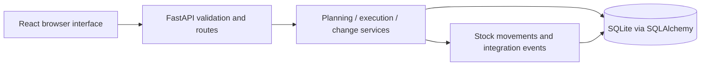

# E-Bike Manufacturing: PP + PLM Simulator

A working educational simulator of discrete production planning and engineering change control for City E-Bike 250W (`EB-1000`). Built with FastAPI, SQLAlchemy, SQLite, React, TypeScript, and Tailwind.

The core workflow is demand → MRP → planned orders / purchase requisitions → production orders → component issue → operation confirmations → output receipt → technical completion. Engineering changes create dated BOM revisions while existing production orders retain copied components and operations.

## Run locally on Windows

Requires Python 3.13 and Node.js 22.20 or compatible versions.

From the project directory:

```powershell
python -m venv .venv
.\.venv\Scripts\python.exe -m pip install -r backend/requirements.txt
Set-Location frontend
npm ci --cache ../.npm-cache
npm run build
Set-Location ..
.\start.ps1
```

Open **http://127.0.0.1:8000**. Interactive API documentation: **http://127.0.0.1:8000/docs**.

If PowerShell blocks script execution, run the equivalent command directly:

```powershell
.\.venv\Scripts\python.exe -m uvicorn app.main:app --app-dir backend --host 127.0.0.1 --port 8000
```

The SQLite database is created and seeded on first startup. Restarting preserves transactions. Rebuilding the frontend requires restarting the backend to serve newly created assets.

For frontend development, run `./start.ps1 -Dev` in one terminal and `npm run dev` from `frontend/` in another. The Vite development server proxies `/api` to port 8000.

## Demo in minutes

For a completely manual run, add demand in **MRP planning**, run MRP, receive buy proposals, then convert and execute make proposals in this order: `BP-402`, `FR-100`, `WH-200`, `DT-300`, `PU-400`, `EB-1000`.

To prepare purchased supply and the five subassemblies automatically through the API:

```powershell
.\.venv\Scripts\python.exe scripts/demo.py
```

This creates demand if needed and leaves the final bike order in `CRTD` for you to execute through the browser. It refuses to run when production orders already exist. `--reset` explicitly replaces all simulator transactions first. `--finish` also completes the final bike order. Neither flag is needed for the initial preparation.

For the final bike order, release it, issue all components, confirm operations 0010 through 0040 in sequence, receive the confirmed output, and technically complete the order. To demonstrate an engineering change, create PU-400 revision B replacing CT-403 with CT-404, then approve and release it. Compare BOM selections before and on its valid-from date.

## What is implemented

- 24 material masters, six make assemblies, six work centers, all sample BOMs, and executable routings for every make material. CT-404 is an extra controller material for the change scenario.
- Master-data creation and maintenance, BOM inspection, and a dated revision register.
- Multi-level MRP with parent-before-component planning, dated projected balances, committed receipts, safety stock, lot-for-lot/fixed/minimum quantities, and lead-time exceptions.
- Reruns supersede unconverted proposals while retaining converted production orders and partially received external supply.
- Production order snapshots, reservations, atomic stock postings, partial/final confirmations, scrap recording, partial receipts, planned/actual illustrative costs, and technical completion.
- Engineering request, approval, release, and evidence-based implementation status; BOM effectivity and nested open-order impact review.
- Dashboard, informational capacity load, module event ledger, physical movement ledger, and repeatable demo fixtures.
- Posting keys prevent a replayed request from posting stock or cost twice. SQLite write transactions serialize concurrent business actions.

## How the pieces fit



MRP changes planning records only. Physical stock changes through the inventory service. Production orders copy the selected BOM and routing at conversion. Released engineering revisions affect date-based selection; they do not rewrite existing order snapshots.

For example, 200 bikes with no opening stock require 200 battery packs and 6,000 cells. Existing assembly stock reduces the quantity to manufacture and therefore the downstream component requirements.

## Verification

```powershell
.\.venv\Scripts\python.exe -m pytest -q --junitxml=artifacts/test-results.xml
Set-Location frontend
npm run build
```

The backend suite includes the complete 200-bike cycle, stock reconciliation, dated netting, lot sizes, shared components, partial receipts, concurrent posting, rollback, illegal actions, and engineering effectivity. Test databases are isolated temporary files. The test command generates a local JUnit report in `artifacts/test-results.xml`. The production frontend build includes TypeScript checking.

## Simulator conventions and limits

- SAP-style labels are educational mappings. Stock is stored on the simplified `MARA` record rather than a separate `MARD`; routings use `PLPO`; make/buy proposals share `PLAF_EBAN`. The system does not reproduce SAP table definitions or configuration.
- One plant and location; calendar-day offsets; BOM valid-from dates are inclusive. The graph validator conservatively rejects cycles across the union of revisions.
- Dated committed supply is remaining production-order output and the balance of partially received PRs. Purchasing is simplified to direct PR receipt, without purchase orders or supplier processing. Early receipt is allowed and immediately available.
- Confirmations require all components issued and earlier operations finally confirmed. Scrap reduces subsequent usable yield. Scrap/rework replenishment and short-closing underdelivered orders are not implemented; a scrapped order may remain confirmed and underdelivered for review.
- Costs use illustrative frozen material prices and activity rates. FI, CO, QM, and SD events are explanations; there is no financial settlement, quality stock, or actual SAP integration.
- Capacity is an informational remaining-load summary, not finite scheduling. Reference units/shift are not used as operation minutes.
- Repetitive and process manufacturing are deferred extensions. There is no CAD/PLMSI connector, full PEO/MES implementation, multiuser authentication, or authorization model.
- Independent demands remain until a demo reset; there is no shipment or sales-demand closure workflow. Dashboard projections are the latest MRP snapshot and must be rerun after execution.
- Released BOMs are immutable. Units and procurement types are fixed after material creation. No unrestricted stock editor is provided.
- Schema creation supports this first release; later model changes require a migration before keeping an existing database.

## Deployment

The app runs locally. A public deployment URL has not been provisioned.

A Dockerfile and Compose file package the frontend with the Python API and persistent SQLite storage:

```powershell
docker compose up --build
```

Compose binds to loopback and enables demo reset. The standalone Docker image disables reset by default. Use one application process with a persistent `/data` volume. A hosted version needs private access controls or isolated per-user demo state before exposing mutation endpoints to shared visitors. The Sites Worker runtime cannot host this FastAPI backend directly.

Technical references consulted during setup: [FastAPI SQL databases](https://fastapi.tiangolo.com/tutorial/sql-databases/), [SQLAlchemy session transactions](https://docs.sqlalchemy.org/en/20/orm/session_basics.html), and [Vite getting started](https://vite.dev/guide/). Package versions are frozen in `backend/requirements.txt` and `frontend/package-lock.json`.
